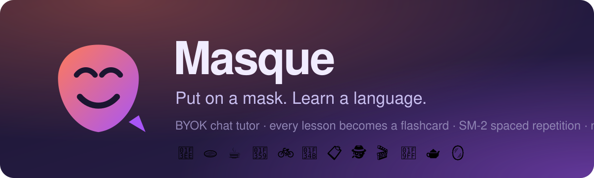
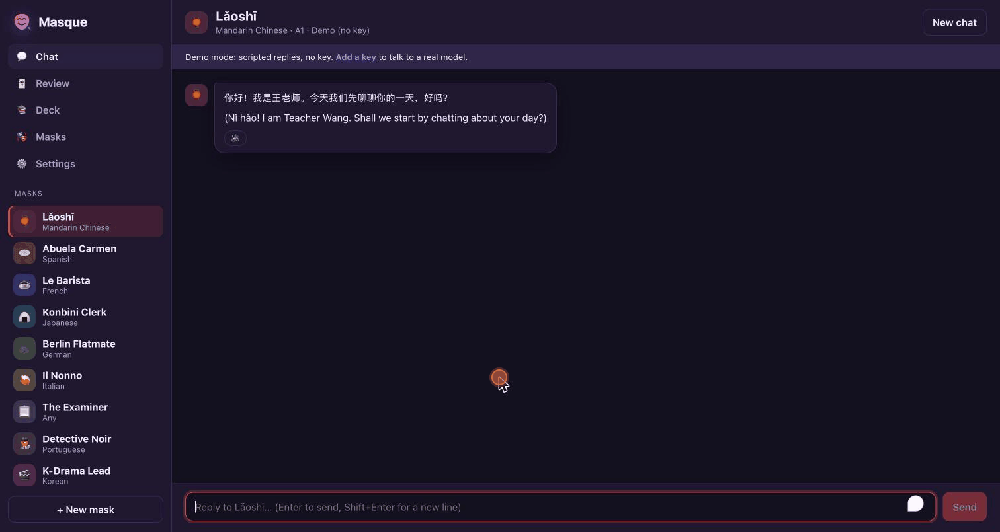
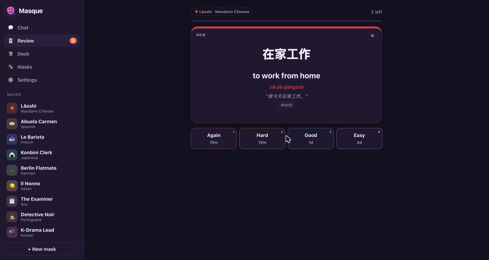
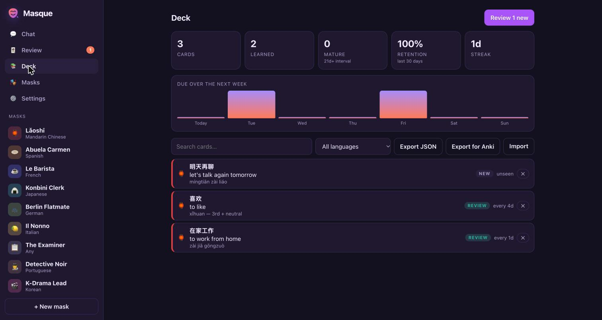
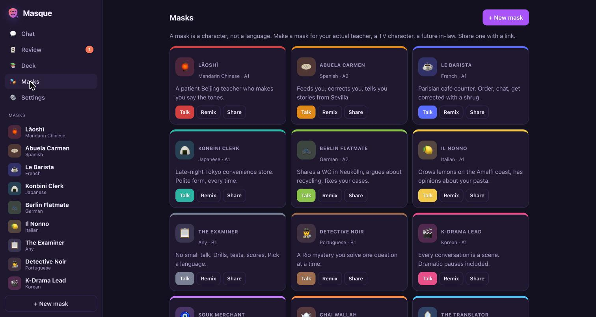
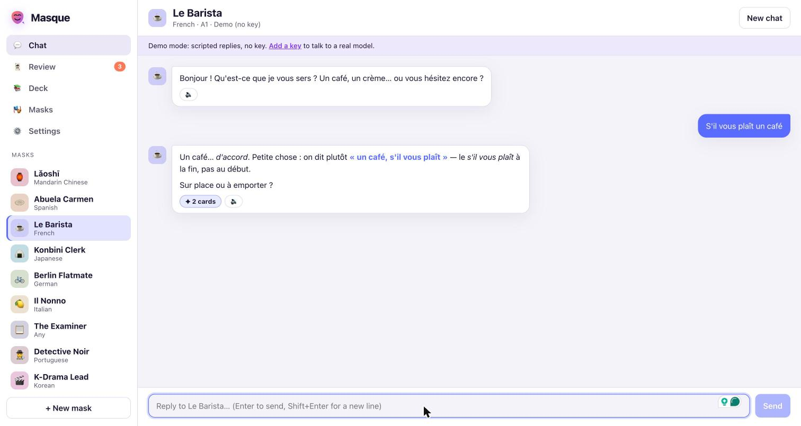
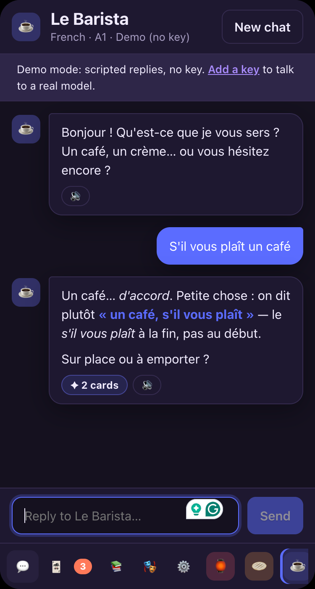

<p align="center">
  
</p>

<p align="center">
  <strong>A BYOK language tutor. Every mask is a character. Everything it teaches you becomes a flashcard.</strong><br/>
  No server. No account. Your key, your browser, your deck.
</p>

<p align="center">
  <a href="https://mohitagw15856.github.io/masque/"></a>
  <a href="https://github.com/mohitagw15856/masque/actions/workflows/ci.yml"></a>
  <a href="LICENSE"></a>
</p>

<p align="center">
  
</p>

## One click to your own copy

| | |
|---|---|
| [](https://vercel.com/new/clone?repository-url=https%3A%2F%2Fgithub.com%2Fmohitagw15856%2Fmasque&project-name=masque&repository-name=masque) | [](https://app.netlify.com/start/deploy?repository=https://github.com/mohitagw15856/masque) |
| [](https://deploy.workers.cloudflare.com/?url=https://github.com/mohitagw15856/masque) | **GitHub Pages:** fork → Settings → Pages → Source: *GitHub Actions*. The workflow is already in the repo. |

It is a static site. There is nothing to configure and no environment variable to set, because the API key never leaves the visitor's browser.

## What it does

1. **Pick a mask.** A mask is a *character*, not a language: a patient Beijing teacher, a nosy Sevillan grandmother, a Parisian barista who corrects you with a shrug, a night-shift konbini clerk who will not let you drop the polite form.
2. **Talk.** The mask stays in character, keeps turns short, corrects one thing at a time, and always leaves you something to answer.
3. **Cards appear.** After every reply the mask hands back the words and patterns it just taught, as a fenced block the app parses and strips. They land in your deck, deduplicated.
4. **Review.** SM-2 spaced repetition with a short learning phase, keyboard shortcuts, read-aloud, and interval previews on every button. Intervals grow every time you remember.

<p align="center">
  
  
</p>

## The masks

| | Mask | Language | What it is like |
|---|---|---|---|
| 🏮 | **Lǎoshī** | Mandarin | A patient Beijing teacher who makes you say the tones. |
| 🫓 | **Abuela Carmen** | Spanish | Feeds you, corrects you, tells you stories from Sevilla. |
| ☕ | **Le Barista** | French | Parisian café counter. Order, chat, get corrected with a shrug. |
| 🍙 | **Konbini Clerk** | Japanese | Late-night Tokyo convenience store. Polite form, every time. |
| 🚲 | **Berlin Flatmate** | German | Shares a WG in Neukölln, argues about recycling, fixes your cases. |
| 🍋 | **Il Nonno** | Italian | Grows lemons on the Amalfi coast, has opinions about your pasta. |
| 📋 | **The Examiner** | any | No small talk. Drills, tests, scores. |
| 🕵️ | **Detective Noir** | Portuguese | A Rio mystery you solve one question at a time. |
| 🎬 | **K-Drama Lead** | Korean | Every conversation is a scene. Dramatic pauses included. |
| 🧿 | **Souk Merchant** | Levantine Arabic | Haggle in Damascus. Numbers, politeness, tea. |
| 🫖 | **Chai Wallah** | Hindi | Roadside chai in Mumbai. Gossip, cricket, cutting chai. |
| 🪞 | **The Translator** | any | Paste anything. Get it back explained, word by word. |

<p align="center">
  
</p>

**Make your own** in the app (Masks → New mask): an emoji, a name, a language, who they are, how they teach, an opening line. **Remix** any built-in. **Share** a mask as a link; the whole mask is encoded in the URL fragment, so there is still no server. Pull requests that add masks are the most welcome kind.

## Bring your own key

| Provider | How |
|---|---|
| **Anthropic (Claude)** | Paste a key from the Claude Console. Calls go straight from the browser with the official SDK. Low effort for snappy turns; server-side fallback on refusals. |
| **OpenAI / compatible** | Paste a key. Set the base URL for OpenRouter, Groq, Together, LM Studio: anything that speaks chat-completions. |
| **Google Gemini** | Paste a key from AI Studio. There is a free tier. |
| **Ollama** | Local models. Run `OLLAMA_ORIGINS="*" ollama serve` so the browser may call it. |
| **Demo** | No key. Scripted replies so you can feel the app. The screenshots above are demo mode. |

Keys live in `localStorage`. Cards and chats live in IndexedDB. Settings has a **Forget keys** button and a **Wipe all data** button. The only network calls the app makes are to the provider you chose.

## How the cards work

The one system prompt tells every mask to end each reply with:

~~~
```cards
[{"front":"une baguette","back":"a baguette","hint":"yn ba-GET","example":"Je voudrais une baguette.","tags":["food"]}]
```
~~~

The parser (`src/lib/cards.ts`) finds the block, validates it, strips it from the visible reply, and the deck deduplicates on `language::front`. It works on any provider because it is just text; there is no tool-calling to wire up per model.

The scheduler (`src/lib/srs.ts`) is SM-2 with a ten-minute learning step and a 365-day cap, ported from my Mandarin90 app and made language-agnostic. It is a pure function with tests. Grades map to SM-2 quality 3–5; *Again* lapses a card back to learning and shrinks its ease. Export to JSON any time, or to a tab-separated file Anki's importer accepts.

<p align="center">
  
  
</p>

## Run it locally

```bash
git clone https://github.com/mohitagw15856/masque
cd masque
npm install
npm run dev
```

`npm test` runs the scheduler and parser tests. `npm run build` type-checks and builds to `dist/`. Set `VITE_BASE=/masque/` when hosting under a sub-path (the Pages workflow does this for you).

## Stack

Vite, React, TypeScript, Dexie for IndexedDB, the Anthropic SDK (lazy-loaded only when you pick Claude). No CSS framework, no state library, no backend. Installs as a PWA.

## FAQ

**Is it safe to put my API key in a web app?**
The key is stored in your browser and sent only to the provider's API. Read `src/lib/providers/` to check; it is small. Deploy your own copy if you want to be certain what code is running. Use a key with a spending limit, as you should anywhere.

**Why not FSRS?**
SM-2 is simple enough to read in one sitting, has no parameters to fit, and behaves predictably on a deck that grows a few cards per conversation. The scheduler is one file; swap it if you want to.

**Does it work offline?**
Review does. Chat needs the provider, or Ollama on your machine.

**Can a mask teach something other than a language?**
Nothing stops you. The cards format is generic.

## License

MIT.
